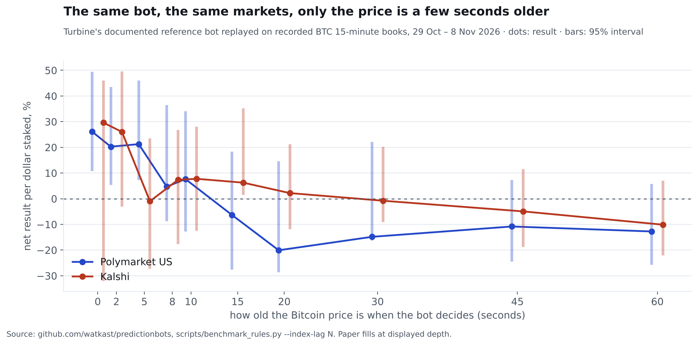

DRAFT — hold until the daily benchmark has 30 days of windows (now 10). Numbers below are from 29 Oct – 8 Nov 2026.

The rule is the one every beginner writes first, and it is the reference example a bot-building platform ships in its
documentation: if the live Bitcoin price is above the market's starting price by more than 0.1%, buy "Up"; below, buy
"Down"; pay up to a confidence-scaled limit; stop a minute before the close; hold to settlement.

## What happened

On our recorded Polymarket US order books, with the bot seeing each Bitcoin index print the instant it was stamped,
the rule made **+26% per dollar staked over 51 markets, 71% winners**, and the 95% interval sat above zero. That is
the screenshot people sell bots with.

Then we asked one question: how old is the price when a real bot acts on it? The index travels from the benchmark
administrator to your server, your server decides, your order travels to the venue. We replayed the identical rule
with the price aged by a few seconds:

| Price age | Polymarket US | Kalshi |
| --- | --- | --- |
| 0 s | +26% (51 trades) | +30% (16) |
| 5 s | +21% (50) | −1% (33) |
| 10 s | +8%, interval includes zero (43) | +8%, includes zero (54) |
| 20 s | −20% (55) | +2% (84) |
| 60 s | −13% (113) | −10% (145) |

## What it means

The rule has no edge of its own. What it had was a head start: in the seconds after Bitcoin moves, the contract
prices have not caught up, and whoever sees the move first buys the stale price. That race is real, it is won in
milliseconds by firms colocated with the data, and a hosted retail bot reading a public feed arrives after it is over.

Two cautions we owe you. Kalshi's sample is small and its curve is noisy (one lag shows an interval above zero, which
is what you expect when you test ten lags). And ten days is one market regime. The daily benchmark keeps replaying this
rule with a 10-second delay; if that changes, this page changes.

*Paper fills at displayed depth. Nothing here is investment advice.*
