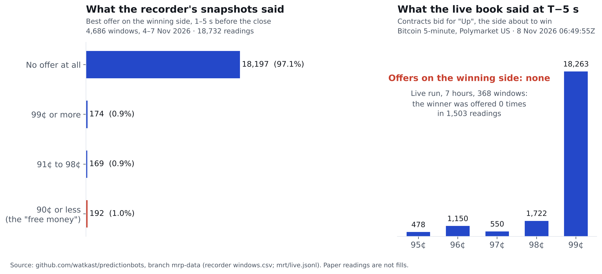

Five-minute crypto markets on Polymarket US and Kalshi settle on a rule, not a guess: "Up" wins if the CF Benchmarks index, **averaged over the last 60 seconds of the window**, is above the opening price. That rule has a consequence anyone can see. With three seconds left, 57 of the 60 prints are already in the average. Unless the index jumps by more in three seconds than it has moved in the previous 57, the outcome is decided.

So if the winning side is ever still offered at, say, 73¢ with three seconds left, you buy it, it pays $1, and you have found free money.

Our recorder said it was. **192 times in four days.**

## What the snapshots said

From 4 to 7 November our recorder stored the order books for every Bitcoin, Ethereum, Solana and XRP 5- and 15-minute market on both venues, alongside the index prints the markets settle on. 4,686 windows. For each one we know which side won and what the book looked like at 5, 3, 2 and 1 seconds before the close: 18,732 readings of the eventual winner's price.

In 97.1% of them, the winning side had **no offer at all**. Nobody sells a contract that is about to pay $1. In another 0.9% it was offered at 99¢ or more, and in 0.9% between 91¢ and 98¢.

That leaves 192 readings, 104 windows, where the eventual winner was offered at 90¢ or less. Some at 70¢. Some at 40¢. A few at 9¢. If those were real, a bot with $5 could buy ten contracts, hold for three seconds, and collect $10. That is the trade people are posting screenshots of.

We built the bot. We called it Mr T.

## What the live book said

Mr T connects to the venue's live market-data stream, watches the index prints arrive one a second, projects the final 60-second average from the prints already in hand, and in the last five seconds compares the projection to the opening price. If the margin is clear and the winning side is offered at 90¢ or below, it fires an immediate-or-cancel buy for ten contracts. We ran it in dry mode: everything except sending the order.

Two runs across a seven-hour span. 368 windows. 1,840 gate readings.

**The winning side was offered zero times in 1,503 readings.**

The raw book at five seconds before the close of the 06:45Z Bitcoin window is the whole story. Bids for "Up," the side about to win: 478 contracts at 95¢, 1,150 at 96¢, 550 at 97¢, 1,722 at 98¢, **18,263 at 99¢**. Offers: none. Across the aisle, "Down" was offered at 1¢ by the thousand and bid by nobody. The market was not asleep. It was perfectly awake, and 18,000 contracts deep in the right direction.

## The bug that fooled us twice

Honesty requires the embarrassing part. Mr T's first run, five and a half hours, reported 162 "qualifying" readings in 35 windows: the leading side offered at 1¢. For about an hour we thought the mirage was real and bigger than the snapshots suggested.

It was a rounding bug. The gate compared `round(projection, 2)` to the opening price; on XRP, where prices carry five decimals, rounding to cents turned a projection a hair *above* the open into a tie, and the tie-break picked the wrong side. All 162 readings were the **loser** offered at 1¢, correctly priced at one cent because it was about to be worth nothing. We removed the rounding, added the raw books to the log, and reran. Zero.

Then we went back to the 192 snapshot readings with that in mind. In 190 of them the recorder also had a *bid* for the winning side, median 37¢. A side about to pay $1, bid at 37¢ and offered at 70¢, three seconds before the close, is not a market; it is a photograph of a market from minutes earlier. The recorder polled snapshots and kept the last one it had. In the last seconds of a window, when the books move fastest, "the last one it had" was stale. The free money was a timestamp problem.

## Why this matters beyond one trade

1. **Every screenshot of a cheap winner you see online has this problem until proven otherwise.** A screenshot is a snapshot. The question is never "what did the book show," it is "how old was the book when you looked."
2. **The market is efficient exactly where people claim it is broken.** Thousands of contracts sit bid at 99¢ in the final seconds. Someone is paid a penny to carry the roughly one-in-a-thousand chance that the index flips in the last three seconds (4 of 4,686 windows in our recordings, and none of them with a margin above 5 basis points). That is the real edge, it belongs to market makers, and it is already fully staffed.
3. **The fee still applies to you.** If you take the 99¢ bid you earn nothing. If you buy "Up" at 99¢ as a taker you pay a fee for a cent of upside. There is no retail version of this trade.

We have retired Mr T as a strategy. The code stays in the repo as a measurement tool, and it now feeds the final-seconds statistics in our data: how deep the winning side is bid, how often the index flips in the last second, by coin, horizon and hour.

## Check our work

- Recorder windows, 4–7 Nov: `windows.csv` on the `mrp-data` branch (63,486 rows; filter `tau <= 5`).
- Live gate log with raw books: `mrt/live.jsonl` on the same branch (1,929 events; `ev == "book_raw"` for the raw books, `ev == "gate"` for every reading and its refusal reason).
- The bot: `scripts/mrt_sniper.py`; the rounding fix is commit `fb436c6c`.
- Everything is at [github.com/watkast/predictionbots](https://github.com/watkast/predictionbots). If you find a window where the winner was really offered below 90¢ on a live book, open an issue with the timestamp. We will publish it.

*Paper readings are not fills. Nothing here is investment advice. We no longer trade; we measure.*
