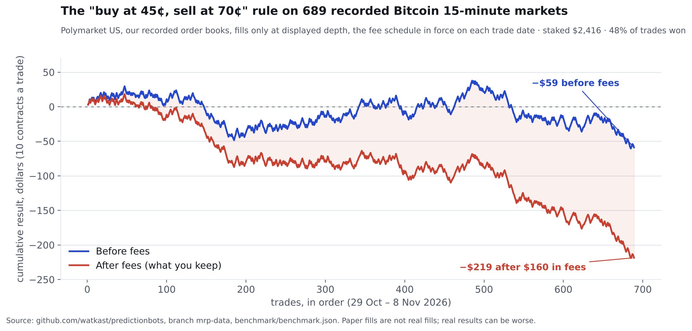

If you have read a tutorial or a vendor page about trading 15-minute Bitcoin markets, you have met this rule: **buy a side when it is 45¢ or less, sell it when it reaches 70¢.** It is the retail strategy of the category, quoted everywhere and tested nowhere we could find. So we tested it, the way the [Bot Benchmark](/#benchmark) tests everything: the rule as published, our recorded order books, fills only where the book showed size, the real fee on the real date.

## The numbers

| Measure | Value |
| --- | --- |
| Windows recorded (BTC 15-minute, Polymarket US, 29 Oct to 8 Nov 2026) | 745; 689 usable (settled, with at least half the window's book on file) |
| Trades | 689 (the rule found a side at 45¢ or less in every usable window) |
| Winners | 48% |
| Staked | $2,416 (10 contracts a trade, or the displayed quantity if smaller) |
| Result before fees | **−$59** (−2.4% of stake) |
| Fees | **$160** (6.6% of stake) |
| Result after fees | **−$219** (−9.0% of stake), about −$0.32 a trade |
| Worst losing run | 7 trades |
| Book coverage | 84% of each window's 15-second buckets, on average |

Before fees the rule is close to a coin flip with a slight lean the wrong way. After fees it is a slope. Fees are 73% of the loss, and they are large relative to the stake because the rule buys cheap contracts: the fee is Θ × price × (1 − price) per share, so measured against what you pay it is heaviest exactly where this rule shops.

## Why the shape is what it is

The rule wins small and loses whole. When the side you bought gets bid at 70¢, you sell for about +25¢ a contract minus two fees: the 331 target exits averaged **+$3.06**. When it never gets there, you hold to settlement, and a side that never reached a 70¢ bid did not win: all 358 held positions lost, averaging **−$3.44**. Forty-eight percent of +$3.06 against fifty-two percent of −$3.44 is a negative number before you have paid a cent of fees.

The cheaper the entry, the worse it went. Trades entered near 40¢ lost 7% of stake; near 30¢, 8%; near 20¢, 35%; near 10¢, 43%. "Cheap" contracts are cheap because the market expects them to lose.

## Is 689 trades enough to say it loses?

The average trade lost $0.32 with a standard error of $0.13, so the loss is distinguishable from zero. It is not distinguishable from "the fee and nothing else": the fee averaged $0.23 a trade, and the pre-fee loss of $0.09 a trade is inside the noise. The honest summary is that the rule has no detectable edge and a certain cost.

A control run in the same windows, buying "Up" at the open and holding, lost 21% of stake; Bitcoin fell over the period and Up settled in only 42% of windows. That number is the period's drift plus a 3.5% fee, not a strategy result, and it is why the benchmark reports a control next to every rule.

## What this row is, and is not

We first saw this rule quoted next to a bot-builder product's pricing, and our early draft of the benchmark carried that vendor's name on the row. That was wrong: the vendor is a platform for running strategies people write, not a bot with this rule in it. The row now says what it is, a rule in general circulation, and the vendor's own published reference bot (buy the side the live price favours against the strike) is queued for its own row. If a vendor has published a rule, send it; we test what is public and we never need your code or your keys.

A second rule in the queue, an open-source fee-aware favorite that only acts in the final two minutes, fired four times in 689 windows and won all four. Four trades is not a result; it is a note that the rule rarely finds a price it is allowed to pay, which agrees with [what we found about the final seconds](/posts/2026-11-08-free-money-that-wasnt.html).

## Check our work

- The replay: `scripts/benchmark_rules.py` (the rules, the fee schedule by date, the fill logic).
- The extracted windows (prices to beat, settlements, one-second index prints, top of book per second): `benchmark/btc15_windows.json.gz` on the `mrp-data` branch.
- The results with every trade: `benchmark/benchmark.json`, regenerated daily.
- Fees: Polymarket US charged 6.95% × price × (1 − price) per share until 1:00 PM ET on 6 November and 9.5% after for accounts under $10,000 of 30-day volume; the replay uses the rate in force at each trade's timestamp. [The schedule, worked at every price.](/learn/polymarket-us-fees.html)

Everything is at [github.com/watkast/predictionbots](https://github.com/watkast/predictionbots). Disagree with the fill assumptions? Open an issue with the window and the book; we will publish the exchange.

*Paper fills at displayed depth are not real fills; real results can be worse. Nothing here is investment advice. We no longer trade; we measure.*
