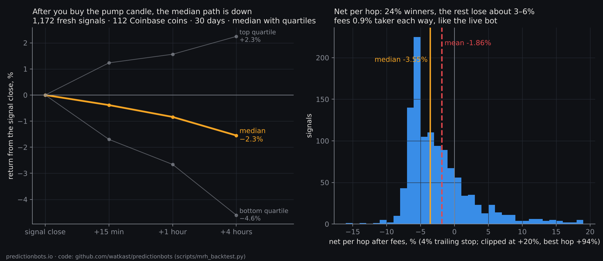
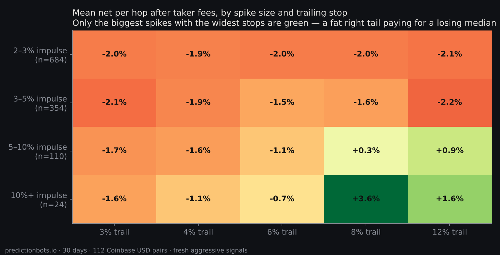

We built a small bot — call it the hopper — with the most popular idea in retail crypto: **buy the coin that is pumping right now and ride it.** The rule was simple and mechanical. On Coinbase Advanced, across every USD pair with at least $100k of daily volume (112 coins), a signal fires when a 5-minute candle closes up 2% or more on at least 3× the two-hour median volume. Buy at the close, trail a 4% stop from the high, sell when it hits. Repeat.

Then, instead of trusting six live trades, we replayed that exact rule — same code path as the live bot, nothing re-implemented — over 30 days of 5-minute history for the whole universe. 5,150 signals, 1,172 of them "fresh" (the first candle of a spike, not the eleven that follow it).

**Here is the whole result in one picture.**

## The numbers

- **Mean net per trade: −1.86%** (after Coinbase's 0.9% taker fee each way). **Median: −3.55%.** **24% winners.**
- The median path *after* the signal: **−0.4% at 15 minutes, −1.2% at one hour, −2.3% at four hours.** The impulse candle is, on median, the local top.
- Strip the fees back out and the gross is about **−0.1%**. The signal itself is a coin flip. **Fees decide the sign.**
- Every trailing-stop width loses (3%, 4%, 6%, 8%, 12%, and "hold four hours, no stop"). Waiting one candle and entering only if the spike held is **worse** (−2.0%): confirmation is not a filter, it is a later entry into the same give-back.
- No hour of the day, no BTC regime, no volume multiple turns it positive. The "closed above the 2-hour high" filter that every momentum tutorial recommends changes the mean from −1.99% to −1.77%.

Our live book agreed before the replay finished: six real hops, three won, three lost, **gross +$0.08, fees −$0.61.** The exchange kept the whole result.

## The one green corner

Only the biggest spikes with the widest stops are positive: **5–10% impulses at an 8% trail made +0.3% a trade** (n=110), and **10%+ impulses made +3.6%** (n=24 — too few to trust). Even there the median trade loses about 3%; the mean is carried by a fat right tail (one hop made +212%; holding another for four hours would have made +369%). That is a lottery-ticket structure with a slightly positive mean, which is exactly what it feels like when you trade it by hand: lots of small losses, the occasional moonshot, and no way to tell which is which at entry.

With maker orders (0.5% each way on Coinbase instead of 0.9%), the bleed on the main rule shrinks from about −2% to about −1.1% a trade. Necessary, not sufficient. You cannot fee-optimize your way out of a signal with no edge.

## Why this is what it is

Think about who is on the other side of a pump candle. Three groups make the move: the people who *manufactured* it (coordinated groups accumulate a thin coin, then post the ticker to thousands of followers at a set time — the followers' buying *is* the pump, and the organizers sell into it), the people with real foreknowledge (listings, treasury moves — using it is a felony, and people have gone to prison for the Coinbase version), and the bots that scrape an announcement and buy within 200 milliseconds.

A 5-minute candle closing up 2% is the footprint of all three having already acted. Buying it makes you, by construction, the late money — and the late money's median path is the first chart.

## What we did with this

1. **Retired "buy the spike" as a strategy.** The hopper still runs, as a deliberately small lottery ticket: ≥5% impulses only, 8% trail, maker orders, capped at four trades a day so fees can never exceed ~4% of the stake per day. We publish its book.
2. **Moved the hunt from forecasting to mechanics.** The only edges that survive small capital are moments where the outcome is *already determined* and the price has not noticed. In prediction markets those exist, and they are small enough that nobody with real money bothers with them. That is the next post: *The last three seconds* — what four days of recording Polymarket US crypto markets at one-second resolution found in the final seconds before settlement, and what happened when we tried to trade it.

## Reproduce it

Everything here is public. The replay is `scripts/mrh_backtest.py` in [github.com/watkast/predictionbots](https://github.com/watkast/predictionbots); the full report, every signal with its forward returns, and the live bot's book are on the repo's `data` branch (`mrh-backtest/BACKTEST.md`, `mrh-backtest/backtest_signals.jsonl`, `mrh-live/LIVE.md`). The fee model is Coinbase Advanced's intro tier; the spread gate (≤0.6%) is not modelled, so live is slightly worse than the table.

If you trade prediction markets or run bots on them, we are building the research and execution terminal we wished we had this week — live scanners for decided markets, final-second candidates and cross-venue locks, with every trade published. [Join the waitlist](/#waitlist).

*Nothing here is investment advice. It is a record of what a rule did, with the code to check it.*
